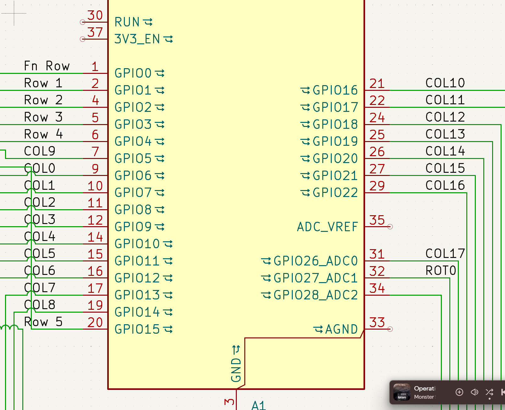
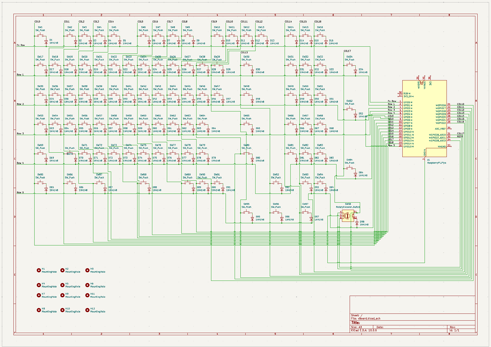
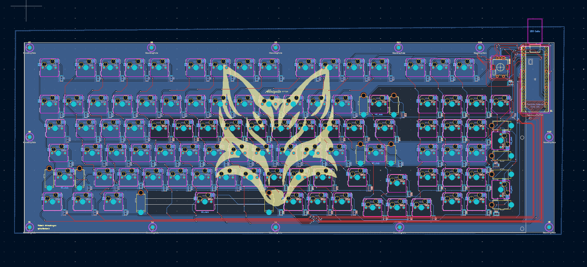
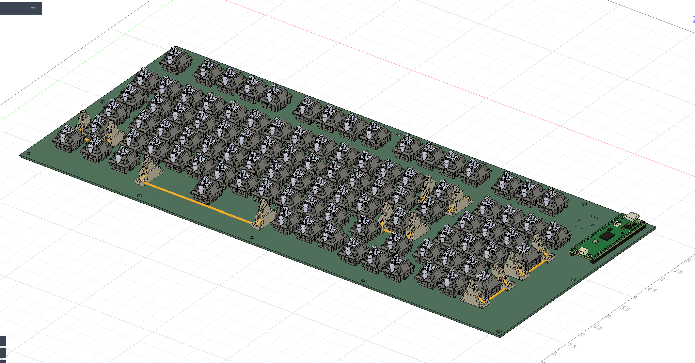
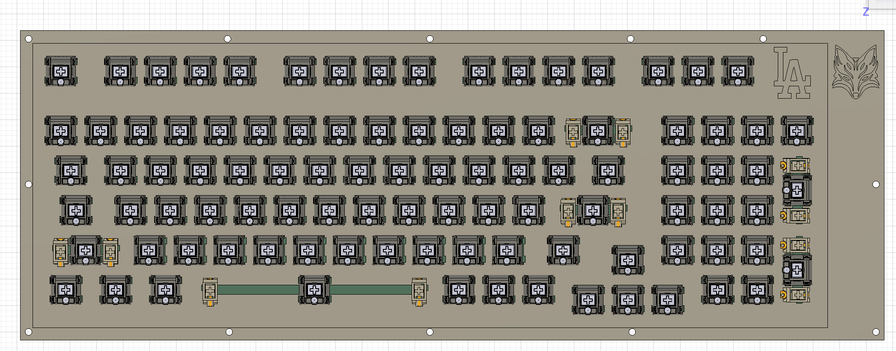
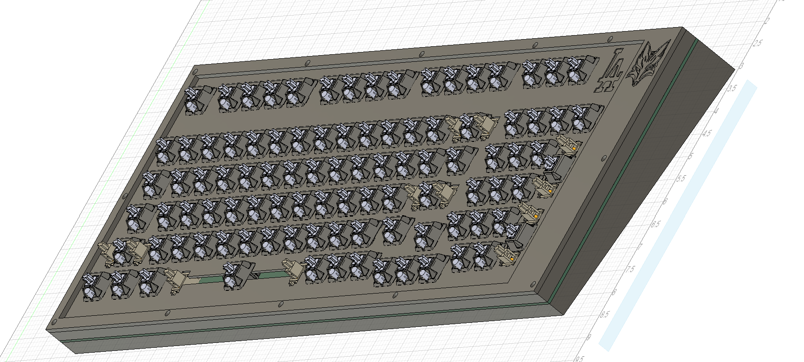

# vBoard

## Overview
This project is a custom-built mechanical keyboard created to replace a failing, non-ergonomic office keyboard used by my English teacher, which was causing him noticeable hand strain during long grading sessions. 

The goal was to build a reliable, tactile, and comfortable typing tool tailored for high-volume daily classroom use.

## Why I Built It
* **Solving a Real Problem:** Standard membrane office keyboards lack tactile feedback, force heavy bottom-outs, and offer no ergonomic support. Watching a favorite teacher struggle with physical discomfort on a broken board made this a high-impact problem to solve.
* **Hands-on Curiosity:** I had always wanted to build a custom mechanical keyboard from scratch to learn about hardware assembly, switch physics, and custom keymapping.

## Features & Specs
* **Ergonomic Layout:** Compact footprint designed to reduce unnecessary reach and wrist movement.
* **Tactile Switches:** Selected for clear physical feedback without requiring excessive actuation force, helping reduce finger fatigue.
* **Custom Keycaps:** Clean, comfortable profile designed for long typing sessions.

## What I Learned
* **Hardware Assembly:** Learned component compatibility across PCBs, plates, switches, and stabilizers, along with basic soldering and hardware assembly.
* **Ergonomics & Physical Health:** Explored how keycap profiles, switch actuation points, and board angles directly affect wrist strain and overall typing comfort.
* **Firmware Configuration:** Discovered how to program custom keymaps and function layers to streamline everyday typing and shortcut tasks.

## Pinout:

## Finished Schematic in KiCad

## Finished PCB in KiCad

## PCB in CAD:

## Finished CAD Models:

## Pricing:
### PCB Fabrication:

### Amazon Cart with Parts:

(PS, I need an Orpheus Pico with this, I just don't know how I'm supposed to get one without KEEB)

## IRL Build (Will post later)
